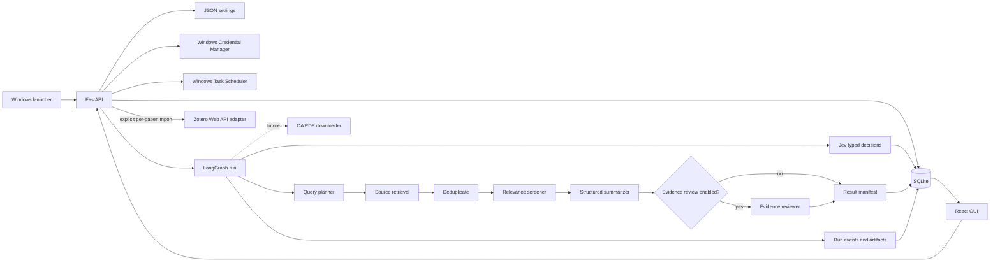

# Architecture

V2 separates orchestration (LangGraph), open-ended generation (OpenAI-compatible LLM), typed decisions (Jev), and deterministic execution. SQLite uses WAL; Alembic owns versioned schema upgrades; queued/running work is recovered by a bounded local worker after restart.



The backend owns task state and run state. The GUI never calls data providers directly. Each graph node receives structured state and returns a structured state update. Provider adapters and the model adapter are replaceable interfaces.

The packaged launcher binds only to `127.0.0.1`, serves the built React application from the same process, checks for an existing healthy instance, and opens the browser. Non-secret settings live beside the selected data directory; secrets are stored per Windows user. Scheduler helpers launch the same packaged executable for login startup and due-subscription checks.

## State invariants

- Every paper has a stable canonical identifier.
- Every run records its current node, progress, status, timestamps, and errors.
- Every completed node writes a run event and one structured artifact.
- Every run uses a snapshot of the versioned prompt catalog available at startup.
- Model output is validated against a JSON shape before persistence.
- A failed source does not fail the entire run.
- Crossref/Semantic Scholar requests share a process-local gate per provider/key: pacing, bounded HTTP 429 retries and Retry-After cooldowns. Each actual request reserves budget; later failures retain earlier query/page records. Only completed queries/full searches enter their respective caches. Crossref supplies configured contact identification. Diagnostics distinguish rate-limited, partial and failed; public-source throttling remains possible.
- Live query plans require valid task-language coverage and bounded keyword queries, with one repair attempt before failure. Runtime planning requirements and repairs are recorded separately from immutable Prompt versions.
- After ordinary/Jev routing, only candidates with relevance >=0.40, no `ignore` recommendation and verified model screening enter live results. Source diversity never overrides this gate. Artifacts retain rejected candidates and counts; target counts are upper bounds.
- Empty live retrieval stays empty; fixture records are restricted to explicit fixture/offline execution. Rejected candidates do not consume summary requests or enter digests.
- Zotero export requires an explicit per-paper action. Review labels alone do not trigger export; ignored papers are blocked. DOI matches reuse existing items and preserve user-edited metadata. Import results are stored per paper and destination library/collection.
- DOI deduplication scans paginated top-level items and compares normalized DOI metadata; quick search is used only for DOI-less title candidates. A failed scan prevents creation. Creation tokens belong to one attempt; later retries scan again.
- Zotero import, data-directory replacement, and backup restoration hold the same nonblocking lock for their entire operation, including local result persistence or global database replacement. Conflicts return HTTP 409.
- The GUI invalidates and reloads destination-specific paper statuses on saved library/collection or configured-state changes, including completed runs. Task and destination generations reject stale responses. Collection keys take precedence over names.
- Settings APIs expose only configuration status, never saved secret values.
- A subscription cannot start a second active run or run twice in its configured local calendar day.
- Task promotion uses an immediate SQLite transaction to attach one subscription and change task ownership without duplicating the task or rewriting its run history. A re-read detects stale task snapshots and duplicate conversions across API/database connections. Manual runs do not count as daily-subscription executions; active runs still block overlapping execution and subscription deletion.

## Convert an existing task to a daily subscription

`POST /api/tasks/{task_id}/subscription` accepts scheduling details only:

```json
{"recipient":"reader@example.org","schedule_time":"08:00","timezone":"Asia/Hong_Kong"}
```

The optional `enabled` field defaults to `true`. Research configuration comes from the current persisted task, including fixed publication dates and explicit Prompt overrides. Success returns HTTP 201 with the existing task ID and a new subscription ID. HTTP 404 means the task is missing; HTTP 409 means it was already converted (includes `subscription_id`) or changed during conversion; HTTP 422 means schedule/task/Prompt validation failed. Conversion neither enqueues a run nor sends mail nor registers OS tasks. The existing Windows due-subscription check/worker handles future execution. `DELETE /api/subscriptions/{id}` returns HTTP 409 while the associated task is queued, running or paused.
