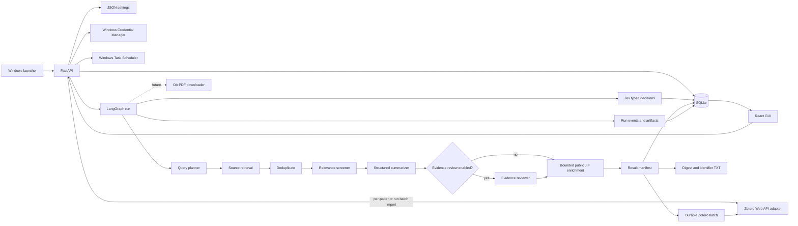

# Architecture

V2 separates orchestration (LangGraph), open-ended generation (OpenAI-compatible LLM), typed decisions (Jev), and deterministic execution. SQLite uses WAL; Alembic owns versioned schema upgrades; queued/running work is recovered by a bounded local worker after restart.

When Jev is configured, screening uses at most `jev_max_inflight` workers, each with its own ordinary HTTP client. Active high-confidence `auto_apply` decisions skip ordinary screening; low-confidence/error decisions fall back, and Shadow always retains ordinary screening. Results are restored to candidate order before ranking. Every ten completions, fifteen elapsed seconds at a completion, or the last completion writes counts to `screening_progress` and an event. Audit records explicitly mark skipped ordinary calls. Jev receives the effective task and screening Prompt; `paper-screen.v3` caches include this context and `LITERATURE_AGENT_JEV_DEPLOYMENT`. Summary/evidence behavior is unchanged. Server LocalJev uses a separate internal authenticated cloud adapter; active promotion is withheld after the [failed real-model gate](LOCALJEV_CLOUD_VALIDATION_2026-10-16.md).



The backend owns task state and run state. The GUI never calls data providers directly. Each graph node receives structured state and returns a structured state update. Provider adapters and the model adapter are replaceable interfaces.

The packaged launcher binds only to `127.0.0.1`, serves the built React application from the same process, checks for an existing healthy instance, and opens the browser. Non-secret settings live beside the selected data directory; secrets are stored per Windows user. Scheduler helpers launch the same packaged executable for login startup and due-subscription checks.

## State invariants

- Every paper has a stable canonical identifier.
- Every run records its current node, progress, status, timestamps, and errors.
- Every completed node writes a run event and one structured artifact.
- Every run uses a snapshot of the versioned prompt catalog available at startup.
- Model output is validated against a JSON shape before persistence.
- A failed source does not fail the entire run.
- Crossref/Semantic Scholar requests share a process-local gate per provider/key: pacing, bounded HTTP 429 retries and Retry-After cooldowns. Each actual request reserves budget; later failures retain earlier query/page records. Only completed queries/full searches enter their respective caches. Crossref supplies configured contact identification. Diagnostics distinguish rate-limited, partial and failed; public-source throttling remains possible.
- Live query plans require valid task-language coverage and bounded keyword queries, with one repair attempt before failure. Runtime planning requirements and repairs are recorded separately from immutable Prompt versions.
- After ordinary/Jev routing, only candidates with relevance >=0.40, no `ignore` recommendation and verified model screening enter live results. Source diversity never overrides this gate. Artifacts retain rejected candidates and counts; target counts are upper bounds.
- Empty live retrieval stays empty; fixture records are restricted to explicit fixture/offline execution. Rejected candidates do not consume summary requests or enter digests.
- Zotero export supports explicit per-paper actions and opt-in task-specific automatic batches. Review labels alone do not trigger export; ignored papers are blocked/skipped. DOI matches reuse existing items and preserve user-edited metadata. Import results are stored per paper and destination library/collection.
- DOI deduplication scans paginated top-level items and compares normalized DOI metadata; quick search is used only for DOI-less title candidates. A failed scan prevents creation. Creation tokens belong to one attempt; later retries scan again.
- Zotero imports and database replacement share one lock through network operations and persistence. API operations use nonblocking acquisition (HTTP 409 on conflict); background batches wait for the lock. Pending batches also block database replacement and deletion. SQLite connection locks never cover network I/O.
- The GUI invalidates and reloads destination-specific paper statuses on saved library/collection or configured-state changes, including completed runs. Task and destination generations reject stale responses. Collection keys take precedence over names.
- Settings APIs expose only configuration status, never saved secret values.
- JIF enrichment runs after selected papers are saved and before run completion, email rendering and automatic Zotero import. Crossref fills missing DOI journal metadata; OpenAlex locates ISSN-verified publisher homepages; explicit publisher JIF/year evidence populates `journal_metrics`. `journal_metric_lookups` (migration `20261017_0005`) caches DOI/ISSN results for 30 days on success or 24 hours on failure/missing. Network requests use at most two concurrent slots and a 60-second run deadline without holding a SQLite lock. Lookup failure never fails delivery. Latest-year reads preserve manual same-year data; conflicting print/electronic matches return no metric. New runs may update journal metadata, never ranking/evidence; historical papers are not automatically enriched. Settings use `PUT /api/settings/journal_metrics`; records/status/template/import use `/api/journal-metrics`. No model estimates or substitute citation metrics. See [API, source limits and validation](JOURNAL_METRICS.md).
- `zotero_target` snapshots automatic destinations before retrieval; completed runs reserve one `zotero_batch.<destination hash>` artifact per destination. Worker startup repairs the completion/enqueue gap and resumes pending batches without retrieval or mail. Each attempt shares a fresh remote DOI/title index; confirmed writes update it, uncertain writes end the attempt so retry rechecks remotely. Library mismatch fails safely. Exact collection membership is checked after import.
- Successful subscription retrieval durably reserves import before SMTP, then attempts mail and import independently. Digests attach a UTF-8 one-identifier-per-paper TXT with deduplication and missing-ID notices; existing runs expose the same export without sending mail. See [Zotero interfaces and operations](ZOTERO.md).
- A subscription cannot start a second active run or run twice in its configured local calendar day.
- Task promotion uses an immediate SQLite transaction to attach one subscription and change task ownership without duplicating the task or rewriting its run history. A re-read detects stale task snapshots and duplicate conversions across API/database connections. Manual runs do not count as daily-subscription executions; active runs still block overlapping execution and subscription deletion.

## Convert an existing task to a daily subscription

`POST /api/tasks/{task_id}/subscription` accepts scheduling details only:

```json
{"recipient":"reader@example.org","schedule_time":"08:00","timezone":"Asia/Hong_Kong"}
```

The optional `enabled` field defaults to `true`. Research configuration comes from the current persisted task, including fixed publication dates and explicit Prompt overrides. Success returns HTTP 201 with the existing task ID and a new subscription ID. HTTP 404 means the task is missing; HTTP 409 means it was already converted (includes `subscription_id`) or changed during conversion; HTTP 422 means schedule/task/Prompt validation failed. Conversion neither enqueues a run nor sends mail nor registers OS tasks. The existing Windows due-subscription check/worker handles future execution. `DELETE /api/subscriptions/{id}` returns HTTP 409 while the associated task is queued, running or paused.

## Single-user server runtime

Explicit `LITERATURE_AGENT_SERVER=true` enables an internal 60-second `DailyScheduler` and Linux `FileSecretStore`. One API process owns one bounded worker; the scheduler reads current settings and subscriptions, applies the existing timezone/day guard and atomically reserves runs with `create_run_if_idle`. Shutdown stops the scheduler before waiting for worker completion. A pause flag suppresses new daily dispatch, not manual runs or startup recovery. See [deployment and migration](SERVER_DEPLOYMENT.md).

`GET /api/settings` exposes `server_mode`; `GET /api/scheduler` reports internal mode, running state, last check and error. Windows scheduler actions, data-directory replacement and online backup restoration return HTTP 409 in server mode. Linux secrets persist via atomic JSON replacement with mode 600; the parent volume must remain private. This is plaintext file protection and does not provide multi-user authentication.

`PATCH /api/subscriptions/{id}` merges exposed form changes with persisted values and updates the existing task. Web editing sends only editable fields, retaining research questions, language/output policy, evidence review, Prompt overrides and history. Existing runs use captured configurations; later runs see saved changes.

The Docker image serves the locally built frontend and API on one port, published only to host loopback. SSH forwards it to the user's local browser; provider calls and email originate on the server. No database synchronization is provided between server and desktop copies.
